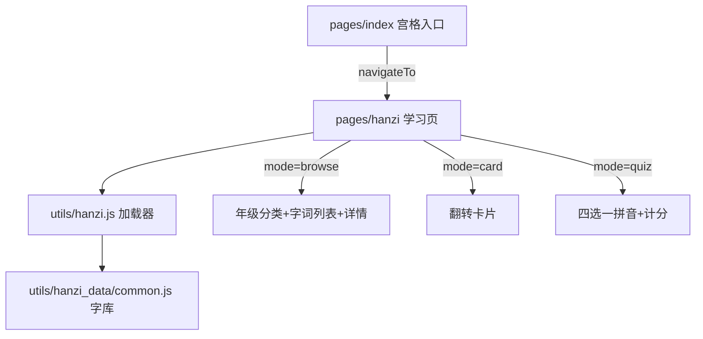

## 用户需求
在微信小程序「百宝箱」中新增「学习汉字 拼音」功能，以三种模式帮助记忆汉字与拼音，数据使用内置的小学常用字库（无需语音朗读）。

## 产品概述
新增一个独立功能页，从首页宫格进入。页面顶部提供「浏览 / 卡片 / 测验」三种模式切换，内置一份按年级分类的小学常用字数据集（含汉字、拼音、声调、释义、组词），纯文字展示，视觉风格与现有「诗词」页面保持一致（橙色主题、圆角卡片、CSS 变量）。

## 核心功能
- 浏览模式：按年级（一年级上/下、二年级上/下等）分类标签页 + 字词列表，点击查看该字的拼音、声调、释义与组词。
- 卡片翻翻看：展示汉字，点击卡片翻面显示拼音与释义，支持上一张/下一张/随机切换并显示进度。
- 测验闯关：给出一个汉字与四个拼音选项（1 正确 + 3 干扰），答题后即时反馈对错与正确拼音，累计得分与进度。
- 字库数据：AI 生成约 250–350 个小学常用字，按年级分组，拼音带声调、释义与组词准确。


## 技术栈
- 平台：微信小程序原生（WXML / WXSS / JS），与现有项目完全一致，不引入新框架或组件库。
- 数据层：沿用 poetry 模式，数据放在 `utils/hanzi_data/common.js`（纯英文路径子目录，规避微信 require 中文路径限制），由 `utils/hanzi.js` 加载器聚合。
- 样式：复用 `app.wxss` 的 CSS 变量（`--primary` `#FF6B35`、`--bg-page`、`--radius-*`、`--shadow-card`），保证视觉统一。

## 实现方案
采用与 poetry 功能相同的「本地数据模块 + 加载器 + 功能页」分层结构，降低认知成本并便于后续扩展（如新增字库分类只需改数据文件）。页面用单一页面承载三种模式，通过顶部分段控件切换 `data.mode`，各模式共享同一字库，避免重复加载。

关键决策：
1. **数据形态**：`common.js` 以 `module.exports = { categories: [{ key, name, chars: [{char, pinyin, tone, meaning, words}] }] }` 导出。年级分类直接驱动浏览模式 tab，无需额外映射。
2. **测验干扰项生成 `genOptions(char)`**：优先从同声调或同声母/韵母的其他字拼音中挑 3 个作干扰（提升区分度），不足时退回随机其他拼音，最后与正确项打乱顺序；保证 4 选项唯一。
3. **翻卡动效**：用 CSS `transform: rotateY` + `transition` 实现 3D 翻转，正面汉字、背面拼音释义，状态用 `flipped` 布尔控制，避免整页重渲。
4. **性能**：字库约 300 条一次性 `require` 进内存，`getChars/search/genOptions` 均为 O(n) 内简单遍历，无网络与渲染瓶颈；列表用 `wx:for` + `wx:key` 稳定更新。

## 实现要点
- 严格复用 `app.wxss` 变量与 index/poetry 既有类名（如 `.header`、`.cat-scroll`、`.safe-bottom`），不新增全局样式污染。
- 测验计分存于 `data`（本页会话内），不强制持久化；如需记忆可用 `wx.setStorageSync` 但本期不做。
- 数据集拼音须带正确声调标调（如 `yī`、`hǎo`），`tone` 为 1–4 数字，供测验/展示使用。
- 翻卡与测验均显示「当前/总数」进度，与 poetry 阅读器进度条风格一致。

## 架构设计


## 目录结构
```
app.json                         # [MODIFY] 在 pages 数组注册 pages/hanzi/hanzi
pages/index/index.js             # [MODIFY] features 数组追加汉字拼音入口 {id:'hanzi', name:'汉字拼音', desc:'翻卡测验，轻松记拼音', icon:'🔤', bg:渐变, url:'/pages/hanzi/hanzi'}
utils/
  hanzi_data/
    common.js                    # [NEW] 小学常用字数据集。按年级导出 categories；每字含 char/pinyin(带声调)/tone/meaning/words。需保证拼音与释义准确。
  hanzi.js                       # [NEW] 加载器。暴露 getCategories()/getChars(key)/getRandom(n)/search(kw)/genOptions(char)。归一化数据并生成测验选项。
pages/hanzi/
  hanzi.js                       # [NEW] 页面逻辑：mode 切换、翻卡 flipped、卡片上/下/随机、浏览年级切换与详情、测验答题与计分。
  hanzi.json                     # [NEW] 页面配置（navigationBarTitleText 等，沿用项目窗口样式）。
  hanzi.wxml                     # [NEW] 三模式布局：顶部标题+分段控件+浏览/卡片/测验三块视图。
  hanzi.wxss                     # [NEW] 页面样式：复用全局变量，实现翻卡 3D、选项卡片、进度等。
```

## 关键代码结构
```js
// utils/hanzi_data/common.js 导出结构（示意）
module.exports = {
  categories: [
    {
      key: 'g1s',
      name: '一年级上',
      chars: [
        { char: '一', pinyin: 'yī', tone: 1, meaning: '最小的正整数', words: ['一个', '第一'] }
        // ... 更多字
      ]
    }
    // ... 更多年级
  ]
}

// utils/hanzi.js 加载器核心接口
function getCategories() {}      // 返回 [{key,name,count}]
function getChars(key) {}         // 返回该年级 chars 数组
function getRandom(n) {}          // 跨年级随机取 n 个字
function search(kw) {}            // 按汉字/拼音/释义模糊检索
function genOptions(char) {}      // 返回 [{text, correct}] 4 项，含 1 正确 + 3 干扰，已打乱
```


## 设计风格
沿用「百宝箱」现有温暖教育风：以主题橙 `#FF6B35` 为强调色，白色圆角卡片承载内容，浅米灰背景 `#F8F6F3`，柔和阴影。整体干净、亲和、易读，与诗词页视觉语言一致，不引入新视觉范式。

## 页面规划（单页三模式）
顶部为橙色标题区（标题「汉字拼音」+ 副标题），其下为分段控件切换「浏览 / 卡片 / 测验」。

- 顶部标题块：橙色背景扁平标题区，白字，与首页 header 同款。
- 模式分段控件：三个胶囊 tab（浏览/卡片/测验），选中态橙色填充、白字，未选浅灰底；点击切换 `mode`。
- 浏览模式块：年级分类横向滚动 tab（复用 `.cat-scroll` 风格）+ 字词卡片列表（每卡显示汉字大号 + 拼音小字 + 释义预览）；点击展开详情（拼音、声调数字、释义、组词 chips）。
- 卡片模式块：居中大翻转卡，正面超大汉字（约 160rpx），背面拼音（带声调、大号）+ 释义；底部「上一张 / 随机 / 下一张」操作与「进度 x/y」；点击卡片 3D 翻转。
- 测验模式块：居中题目汉字大号；下方四个拼音选项卡片（2x2 或纵向），点击即时高亮对（绿）/错（红）并展示正确拼音；顶部显示得分与剩余进度。

## 交互与动效
- 翻卡：CSS `rotateY` 3D 翻转 + 250ms 缓动，正反面切换。
- 选项反馈：选中正确绿色 `--color-success`、错误红色 `--color-danger`，并短震动 `wx.vibrateShort`。
- 模式切换、tab 切换均有 150ms 过渡，保持轻盈。
- 响应式：基于 rpx，适配各尺寸；底部 `.safe-bottom` 安全区。
